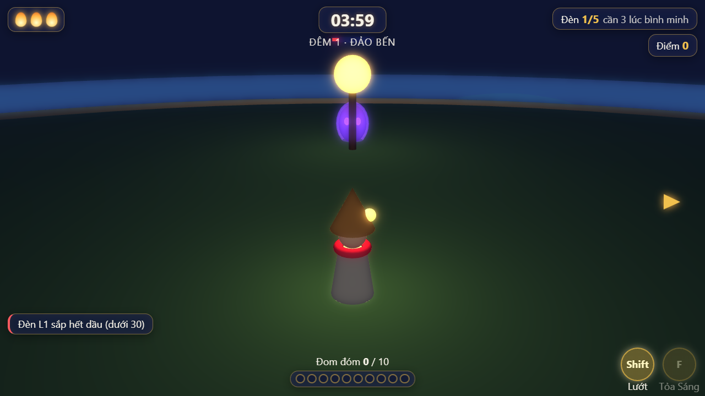
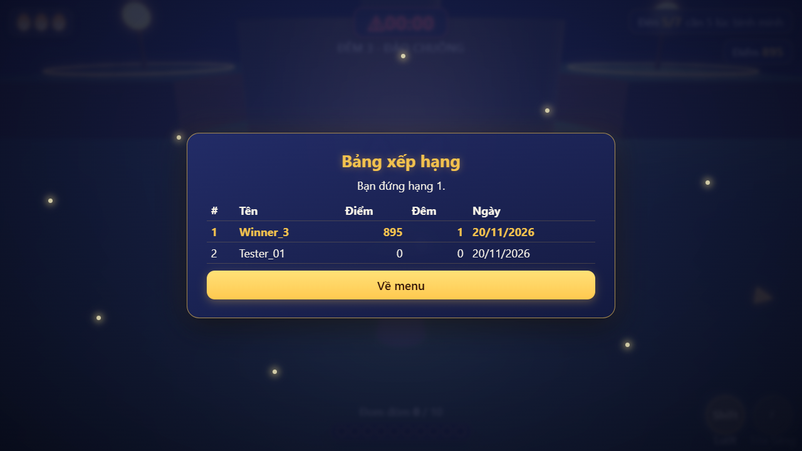

# Đảo Đèn Lồng (Day 12 — AI SDLC) · v1.0.0

> **Video demo (dưới 5 phút):** [GitHub Release v1.0.0](https://github.com/buianhdung2kar5/K5-L3A-Day12-BuiAnhDung-2A202603687-AI-SDLC-Dao-Den-Long/releases/tag/v1.0.0) (file `demo.mp4`; video do script tự chơi và ghi lại)

Game 3D góc nhìn thứ ba chạy trên trình duyệt (TypeScript + Babylon.js). Mây, người giữ đèn nhỏ tuổi, gom đom đóm để thắp và **giữ sáng** các Đèn Lồng Lớn trên ba hòn đảo (Đảo Bến, Đảo Cau, Đảo Chuông) cho tới bình minh, trong khi Bóng Mực tới hút dầu đèn.




## Yêu cầu hệ thống

- Node.js 18 trở lên (chạy trên macOS, Linux, Windows).
- Trình duyệt hiện đại có WebGL2 (Chrome, Edge, Firefox); card đồ họa tích hợp là đủ.
- Chỉ cho `npm run bench` và `npm run e2e`: cài Chrome hoặc Chromium (hoặc đặt biến `CHROME_PATH`).

## Cài đặt và chạy (3 lệnh)

```bash
npm install
npm run build
npm start        # mở http://localhost:8080 (PORT=3000 npm start để đổi cổng; tự chuyển cổng khác nếu bận)
```

Bản phát hành (thư mục web tĩnh + server Node không phụ thuộc gói ngoài) nằm trong [Release v1.0.0](https://github.com/buianhdung2kar5/K5-L3A-Day12-BuiAnhDung-2A202603687-AI-SDLC-Dao-Den-Long/releases/tag/v1.0.0): giải nén rồi chạy `node scripts/serve.mjs`.

## Điều khiển (đổi được trong Cài đặt)

WASD đi · Space nhảy · Shift lướt · E nạp đom đóm vào đèn / châm dầu · F Tỏa Sáng (tốn 3 đom đóm) · Esc tạm dừng · mũi tên trái/phải hoặc kéo chuột xoay camera · R chơi lại Đêm. Cài đặt: âm lượng, độ nhạy chuột, **bảng màu dễ phân biệt**, **giảm chuyển động** (tắt rung camera và chớp màn hình), **chữ lớn ×1.25**, **đổi phím** (báo trùng phím, khôi phục mặc định). Phụ đề/chỉ báo hình ảnh: Bóng Mực xuất hiện (kèm mũi tên ở mép màn hình), gió sắp thổi, 10 giây cuối, đèn dưới 30 dầu.

## Luật chơi

- Đèn mới cần 10 đom đóm để thắp, đèn từng sáng mà tắt chỉ cần 5. Đèn có **dầu** 100, hao 1 mỗi giây; bấm E ở đèn đang sáng để châm dầu (mỗi đom đóm +10 dầu). Hết dầu thì đèn tắt.
- Bóng Mực hút dầu đèn yếu (dưới 30): đèn yếu mất vùng an toàn 6 m. Tỏa Sáng làm bóng choáng; châm dầu lên 30 trở lên thì bóng trong vùng bị đẩy ra.
- **Thắng khi hết giờ** (240/270/300 s) mà Mây còn sống và còn ít nhất 3/5, 4/6, 5/7 đèn sáng. Hết Ngọn Lửa (3) hoặc ít đèn hơn ngưỡng thì thua. Rơi khỏi đảo mất 1 Ngọn Lửa và toàn bộ đom đóm.
- Mỗi lần thắp thành công tăng sức chứa 2 (từ 10, tối đa 20). Đảo Cau có cầu tre, bục nhảy, Gió Lạc (cướp đom đóm) và Bùa Gió; Đảo Chuông có 3 tầng, dốc, tháp chuông và gió mạnh.
- **Điểm:** +5 mỗi đom đóm nạp/châm · +100 thắp lần đầu · +40 thắp lại · +5 mỗi Bóng Mực trúng Tỏa Sáng (+15 nếu đang hút dầu) · khi thắng: +50 + `floor(dầu)` mỗi đèn còn sáng và +50 mỗi Ngọn Lửa. Tổng điểm là tổng các Đêm đã thắng.
- **Bảng xếp hạng** top 10 (menu chính): sau khi thua hoặc sau màn Bình Minh, nhập tên 3-12 ký tự (chữ, số, `_`) để lưu. Lưu trên đĩa bởi server (`data/leaderboard.json`); `node scripts/serve.mjs --export-leaderboard out.json` xuất `{"entries": [...]}`.

## Test, headless, benchmark, soak

```bash
npm test         # build + 129 kiểm tra headless (tính tay, tất định, thời gian một Đêm, soak, bảng xếp hạng) -> docs/proof/phase4/
npm run e2e      # 31 kiểm tra trên game thật trong Chrome (phím thật, đổi phím, bảng xếp hạng, chữ >= 18 px, bench) + FPS bằng GPU thật
node dist/headless.js --seed 1 --night 2 --ticks 600 --out out.jsonl [--scenario s.json] [--inputs i.json] [--snapshot-every 10]
npm run bench    # node scripts/bench.mjs --seed 42 --duration 30 --out bench.json   (cảnh chuẩn: 200 Bóng Mực + 100 đom đóm, camera bay vòng)
npm run soak     # node dist/soak.js --seed 7 --nights 10 --out soak.json            (10 Đêm trong một tiến trình)
```

- **Benchmark trên web:** cửa sổ 1280×720 không toàn màn hình, Chrome headless (`--headed` để hiện cửa sổ). Chrome gắn `requestAnimationFrame` với tần số quét màn hình và khi mở khóa thì cứ khoảng 0.5 s lại đứng ~200 ms, nên cảnh bench dùng vòng lặp `MessageChannel` + `gl.finish()` (tần số khung không bị vsync giới hạn, `vsync_off: true`). `peak_mem_mb` là working set của cả cây tiến trình Chrome (3 mẫu ngay sau khoảng đo, xấp xỉ đỉnh); `peak_js_heap_mb` là đỉnh heap JS. Chi tiết và các giả định: [docs/notes/phase4-assumptions.md](docs/notes/phase4-assumptions.md).
- Kết quả tự chạy: [bench.json](bench.json), [soak.json](soak.json) (số đo chỉ trên máy của tôi, xem trường `renderer` và `os`).

## Tài liệu

Contract: [game.contract.json](game.contract.json) (v1.3) · Yêu cầu và giả định theo phase: [ticket-02](docs/notes/ticket-02.md), [ticket-03](docs/notes/ticket-03.md), [ticket-04](docs/notes/ticket-04.md), [phase2](docs/notes/phase2-assumptions.md), [phase3](docs/notes/phase3-assumptions.md), [phase4](docs/notes/phase4-assumptions.md) · Quyết định thiết kế: [ADR-0001](docs/notes/adr-0001-fuel-model-and-dawn-win.md) · [CHANGELOG.md](CHANGELOG.md) · [CREDITS.md](CREDITS.md) · [LICENSE](LICENSE) · Bằng chứng từng phase: [phase1](docs/proof/phase1/), [phase2](docs/proof/phase2/), [phase3](docs/proof/phase3/), [phase4](docs/proof/phase4/) (mỗi thư mục khớp tag của phase đó) · Nhật ký dùng AI: [phase1](docs/notes/phase1-ai-log-and-retro.md), [phase2](docs/notes/phase2-ai-log-and-retro.md), [phase3](docs/notes/phase3-ai-log-and-retro.md), [phase4](docs/notes/phase4-ai-log.md) · **Retro tổng kết:** [docs/notes/retro.md](docs/notes/retro.md).

## Sáng tạo của tôi

Các ý thêm ngoài phần lõi (tất cả tắt hoặc không ảnh hưởng đầu ra headless; cảnh benchmark dùng cờ `bench` tắt gameplay):

| Ý sáng tạo | Bằng chứng ngắn | Test |
|---|---|---|
| Bóng Mực có mắt, viền tím phát sáng, phình lên khi đang hút dầu | [ảnh](docs/proof/phase4/screens/e2e-drain.png) | `shade_walks_to_weak_lantern_and_drains` (e2e) |
| Gió Lạc (dải lụa cướp đom đóm) | [ảnh](docs/proof/phase4/screens/e2e-drifter.png) | `night2_drifter_steals` (e2e), `drifter_steals_3_and_flees` (headless) |
| Bùa Gió (chạy 7.2 m/s, lướt không hồi chiêu) | [ảnh](docs/proof/phase4/screens/e2e-charm.png) | `night2_charm_pickup_speed` (e2e), `charm_*` (headless) |
| Bảng màu dễ phân biệt, đèn tắt xẹp và có vết rách | [ảnh](docs/proof/phase4/screens/e2e-colourblind-settings.png) | `colour_blind_setting_persists` (e2e) |
| Lời Ông Đăng mở đầu mỗi Đêm, giao diện kính mờ, đom đóm bay ở menu | [ảnh](docs/proof/phase4/screens/e2e-intro.png) | `menu_intro_play_flow` (e2e) |
| Nhạc nền và hiệu ứng âm thanh tự tổng hợp bằng Web Audio (không dùng tệp âm thanh) | `src/web/audio.ts` | **chưa nghe thử** trong môi trường kiểm thử, chưa có bằng chứng |

---

## Tài liệu của lab

| File | Nội dung |
|---|---|
| [GUIDE.md](GUIDE.md) | Hướng dẫn làm lab: vòng làm việc mỗi phase, harness, kiểm chứng, token |
| [CHECKPOINTS.md](CHECKPOINTS.md) | Các mốc tự kiểm tra từ chuẩn bị đến nộp bài |
| [SUBMISSION.md](SUBMISSION.md) | Đặt tên repo, hạn nộp, tag, Release, video, checklist |
| [RULES.md](RULES.md) | Quy định: AI, trung thực về bằng chứng, bản quyền, bảo mật |
| [RUBRIC.md](RUBRIC.md) | Thang điểm chi tiết |

## Lab board

Yêu cầu dự án được phát hành tại **[Đảo Đèn Lồng Lab](https://claude.ai/artifact/Q1RYyv1dxjUczzCbd2ZnoW)**. Mỗi phase là một tab (tab chưa phát hành bị khóa), mỗi tab có trợ giảng AI riêng chỉ trả lời trong phạm vi phase đó. Trợ giảng cần đăng nhập claude.ai và dùng lượt Claude của bạn.

## Dự án

**Đảo Đèn Lồng**: game 3D góc nhìn thứ ba. Mây, người giữ đèn nhỏ tuổi, gom đom đóm để thắp lại các Đèn Lồng Lớn và né Bóng Mực trong sương đen.

- Không ràng buộc công nghệ; chạy được trên macOS hoặc Linux.
- Tuân theo **Test Contract** (chế độ headless) để được chấm tự động và so sánh với nhau.

| Phase | Bạn nhận | Nộp |
|---|---|---|
| 1 | **PRD-0** (mô tả tổng quát) + Test Contract | tag `phase-1` |
| 2 | **Ticket-02**, phát hành khi Phase 1 kết thúc | tag `phase-2` |
| 3 | **Ticket-03**, phát hành khi Phase 2 kết thúc | tag `phase-3` |
| 4 | **Ticket-04**, phát hành khi Phase 3 kết thúc | tag `phase-4` + Release `v1.0.0` |

Yêu cầu sẽ được bổ sung và có thể thay đổi giữa các phase, giống dự án thật.

### Lịch 4 giờ

Bài lab kéo dài **4 giờ**. Phase 1 và 2 khoảng **1 giờ**, Phase 3 khoảng **30 phút**, Phase 4 khoảng **1 giờ 30 phút**. Mỗi phase phát hành đúng mốc giờ. Phase mới xuất hiện trên lab board khi tới mốc.

| Mốc | Sự kiện | Hạn tag |
|---|---|---|
| 0h | Phát hành **Phase 1** (PRD-0), gồm cả phần chuẩn bị | `phase-1` trước mốc 1h |
| 1h | Phát hành **Phase 2** | `phase-2` trước mốc 2h |
| 2h | Phát hành **Phase 3** | `phase-3` trước mốc 2h30 |
| 2h30 | Phát hành **Phase 4** | `phase-4`, Release `v1.0.0` và video trước mốc 4h |
| 4h | Hết giờ lab, chốt bài | |

Hết giờ mỗi phase thì tag và chuyển sang phase tiếp theo, dù phase chưa hoàn hảo. Chỗ chưa xong ghi trung thực trong bằng chứng.

---

## Gợi ý SDLC (cách làm là của bạn)

Mỗi phase là một vòng nhỏ. Công cụ, thứ tự, định dạng tài liệu đều tự do; đây chỉ là gợi ý:

1. **Requirements:** biến yêu cầu thành tiêu chí nghiệm thu kiểm chứng được. Chỗ mơ hồ thì tự giả định và ghi lại.
2. **Plan:** nghĩ cách kiểm chứng **trước** khi để agent viết code.
3. **Build:** để agent viết, bạn điều phối và review.
4. **Verify:** chạy thật, kiểm tra hành vi thật. *Không có bằng chứng thì chưa xong*: "agent bảo chạy rồi" không phải bằng chứng.
5. **Evaluate:** cái gì đạt, AI sai ở đâu, harness (AGENTS.md, skill, hook) cần chỉnh gì.
6. **Release:** gắn tag.

## Ba điều cần nhớ

> Bạn được **tự do sáng tạo thêm** quanh phần lõi (nhân vật, cơ chế nhỏ, câu chuyện, hiệu ứng, âm thanh…). Sáng tạo gọn và không phá yêu cầu được tính điểm trong hạng mục F của [RUBRIC](RUBRIC.md); ghi mục "Sáng tạo của tôi" trong README của bạn.

- **Game tốt là game đúng yêu cầu của khách hàng**, không phải game phức tạp hay đẹp nhất. Làm đúng và chứng minh được là đúng trước, trau chuốt sau.
- **Cân nhắc kỹ quota token của bạn.** Đốt nhiều token không làm bài tốt hơn. Ngữ cảnh gọn, kế hoạch rõ, kiểm chứng sớm thường vừa rẻ vừa đúng hơn chạy agent liên tục.
- **Kiểm chứng là phần quan trọng nhất.** Bằng chứng (test, output headless, ảnh, số đo) đáng giá hơn lời mô tả.

---

## Bàn giao cuối cùng

Một **repo GitHub cá nhân, public**, gồm:

1. **Toàn bộ mã nguồn** của game qua 4 phase, tag `phase-1` … `phase-4`, Release `v1.0.0`.
2. **Video demo `.mp4` dưới 5 phút** (đính kèm Release `v1.0.0` hoặc `docs/demo/demo.mp4`, link ở đầu README): chơi thử và cho thấy bằng chứng game chạy đúng.
3. **Bằng chứng kiểm chứng** của từng phase (định dạng tự chọn).
4. **Harness AI đã dùng** (AGENTS.md / CLAUDE.md, skills, hooks, plugins…), giữ nguyên trong repo và lịch sử git.
5. **Ghi chép ngắn:** spec/giả định mỗi phase, nhật ký dùng AI (gồm token/chi phí ước tính), retro.

Không commit API key, token hay `.env`. Gửi link repo theo hướng dẫn của Coach.

## Đánh giá (100 điểm)

| Hạng mục | Điểm |
|---|---|
| Test tự động ẩn (headless, gồm kiểm tra lại phase trước) | 30 |
| Kiểm chứng & bằng chứng của bạn | 20 |
| Quy trình SDLC & harness AI | 15 |
| Evaluation & retro (gồm cách bạn dùng token) | 10 |
| Hiệu năng & ổn định | 10 |
| Chất lượng sản phẩm (đúng yêu cầu, chơi được) | 10 |
| Video demo | 5 |

## Quy định

- Dùng AI thoải mái; không sao chép repo của người khác.
- Bằng chứng phải thật: test luôn đạt hay output sửa tay là vi phạm.
- Nhân vật, bối cảnh là bản gốc của lab; asset bên ngoài chỉ dùng loại CC0/CC-BY/MIT hoặc tự tạo, ghi nguồn trong `CREDITS.md`.
